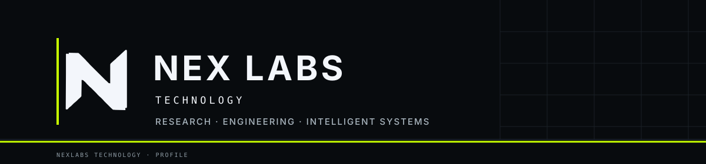

  

<strong>Research-led engineering for human-centered intelligent systems.</strong>

  <a href="https://github.com/KayzenRoot/nexlabs-website">Browse the website source</a>
  &nbsp; · &nbsp;
  <a href="https://github.com/csn1985?tab=repositories">Explore public repositories</a>

---

## 🚀 Our direction

NexLabs Technology is an **AI-native technology company and product studio**. We explore intelligent systems that connect software, data, and real-world operations through focused research and evidence-first engineering. Our focus is on owned digital products and reusable technology, not generic outsourced development.

## 🧭 Focus areas

| Focus | What we explore |
| --- | --- |
| ⚙️ Artificial Intelligence | Useful reasoning, automation, and human-centered workflows. |
| 🧱 Intelligent infrastructure | Reliable, observable, and adaptable software and data foundations. |
| 🪟 Advanced interfaces | Clearer ways to understand, operate, and collaborate with complex systems. |
| 🌱 Sustainable technologies | Efficiency, responsible resource use, and long-term operational thinking. |
| 🔬 Research platforms | Testable systems that turn technical questions into measurable learning. |

## 🛠 How we build

**Human-centered** · **Research-led** · **Secure by design** · **Built for real-world systems**

We use evidence, thoughtful engineering, and clear interfaces to make difficult problems more understandable and adaptable.

## 🔭 Public work

- [NexLabs website source](https://github.com/KayzenRoot/nexlabs-website) (in development; public production launch not approved)
- [All public repositories](https://github.com/csn1985?tab=repositories)
